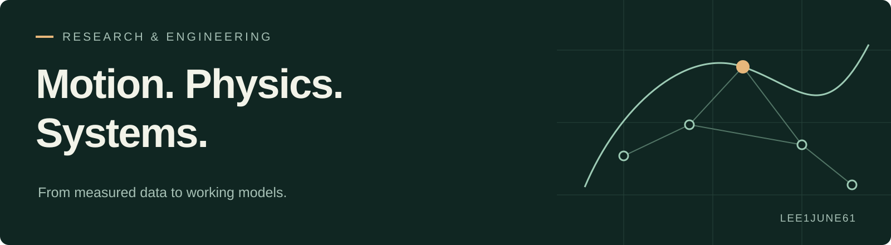

I build research prototypes that connect **measured data, physical models, and machine learning**. My current focus is baseball: how an athlete moves, how a bat and ball collide, and how to test the assumptions behind each model.

**Explore:** [Featured research](#featured-research) · [Selected projects](#selected-projects) · [How I work](#how-i-work)

## Featured research

### [Baseball World Model](https://github.com/lee1june61/Baseball-World-Model)

**From the athlete's body to the moment of impact.**

| Human motion | Contact physics |
|:---|:---|
| Athlete-specific bodies and measured pitching/hitting references connected to a shared MuscleMimic policy | Finite-duration 3D collision with compression, friction, bat bending, torsion and vibration |
| 197 athletes · 1,074 reference motions · athlete-disjoint splits | Runnable CPU example · physical consistency checks · 30-trial measured replay |
| **Stage:** preparation and training-state validation; GPU policy performance remains unverified | **Stage:** working simulator with documented calibration and uncertainty |

[Project overview →](https://github.com/lee1june61/Baseball-World-Model) &nbsp; [Human model](https://github.com/lee1june61/Baseball-World-Model/blob/main/docs/HUMAN-MODEL.md) &nbsp; [Contact model](https://github.com/lee1june61/Baseball-World-Model/blob/main/docs/CONTACT-MODEL.md) &nbsp; [Run an example](https://github.com/lee1june61/Baseball-World-Model/blob/main/docs/REPRODUCING.md)

Human previews are retargeted reference motions, not learned rollouts. Contact measurements cover one softball participant. Upstream models, data and their reuse terms are credited in the project.

## Selected projects

| Project | What it explores | Tools |
|:---|:---|:---|
| **[GC-GISMo](https://github.com/lee1june61/CS471-Project)** KAIST CS471 team project | Goal-conditioned ingredient substitution: balancing flavor preservation with sugar and sodium reduction, using graph structure and nutrient information | Python · PyTorch · graph learning |
| **[SafeHome](https://github.com/lee1june61/cs350_safehome_team1)** KAIST CS350 team project | A residential security simulation with synchronized control-panel and monitoring interfaces, shared state, authentication and sensor behavior | Python · Tkinter · SQLite |

## How I work

- **Make the model inspectable.** Document the physical assumptions, data boundaries and interfaces.
- **Separate evidence from ambition.** Keep numerical checks, measured validation and future work clearly identified.
- **Make experiments repeatable.** Save configurations, split definitions, checkpoint state and compact result artifacts.

**Working toolkit:** Python · NumPy · SciPy · PyTorch · JAX · MuJoCo · GitHub Actions

---

[Browse all repositories](https://github.com/lee1june61?tab=repositories)
